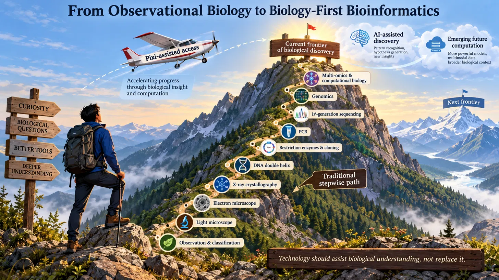

# Biology-First Bioinformatics

**A collection of Pixi ecosystems that start from the biological question**

> **Status (November 2026): under construction.** The collection is released one ecosystem at a time, after each has been reviewed and tested, and the documentation is still being improved. The ecosystem table below shows where each one stands. Every project starts with **discoveryflow**. Please look at this page and the repositories on GitHub from time to time to see what has changed. To be told when something is released, use **Watch → Custom → Releases** on a repository, and read its `CHANGELOG.md`.

## Why I built this

I am a microbiologist, recently retired after decades in microbiology, metagenomics and microbial ecology. I come from a time when mentoring was a central part of scientific life. A senior scientist passed on not only results but the reasoning behind them: how to think about a problem, how to recognise that something is wrong, and what a result means before the statistics confirm it. Today the online resources are abundant, but the guided navigation through them is often missing.

The concepts and principles of microbial ecology are not new. Winogradsky and Beijerinck laid the foundations in the late nineteenth century, Hungate brought quantitative ecology to the rumen in the 1950s, and the field took off in the 1970s: the journal *Microbial Ecology* was first published in 1974, and the *ISME Journal* followed in 2007. What has changed is the technology, and it will keep changing. For a century we studied the small fraction of microbes that would grow on a plate. In 1985 Staley and Konopka named the mismatch between the cells counted under the microscope and the colonies that grew on agar the “great plate count anomaly”, and showed that in many natural habitats far less than 1% of the cells could be cultured. The way around the problem came within a year, when Pace and colleagues proposed cloning and sequencing 16S rRNA genes directly from environmental samples without culturing the microbes (Pace, Stahl, Lane and Olsen, 1986). The 16S rRNA gene then provided the direct evidence of what we had been missing, revealing the true extent of microbial biodiversity without growing anything. Shotgun metagenomics and then metagenome-assembled genomes (MAGs) went further, giving us whole genomes of organisms that no one has cultured. That step, more than any other, carried microbial ecology into the microbiome era.

Each of these advances brought a new layer of tools, and with it a new layer of skills that a biologist must learn before the biology can begin. Biologists are not IT professionals, yet the tools are written by IT professionals, in their own jargon, and with a very wide range of parameters, most of which a biologist does not need for the analysis in hand. The result is that biologists often misuse the tools, or give up on them, not because the biology is difficult but because the tools were not written with them in mind.

We cannot yet clone brains, so the experience of a mentor cannot simply be copied into a new scientist. Until that is possible, I think we should try to narrow the divide between the understanding that comes from experience and the skills that the new technologies demand.

When I began, sequencing a single gene fragment took a week. It was done by hand and read band by band off X-ray film, and some programs had to be compiled from source on a Solaris workstation before any biology could start. The technology has changed beyond recognition. The experience of a biologist whose tool will not install has changed far less.

So I have tried to build the missing mentoring into the tools themselves. Each ecosystem installs with a few commands, and each README is written to do what a mentor would do (see “How the documentation is written” below). None of the more than 500 tools in these ecosystems is mine, and the credit for them belongs to their authors. What I contribute is the way they are brought together, tested and explained, so that a biologist can spend the time on biology.

## Why this collection was developed: bridging the understanding and skills abyss

### From observational biology to today’s computational frontier

Biology begins with curiosity, observation and basic questions. Over the past three to four decades, molecular methods, sequencing and genomics have greatly widened what a biologist can investigate. The journey from field observation and cultivation to molecular biology and genome-resolved research has brought with it new vocabularies, data formats, software environments and computational methods. Figure 1 shows that path as a mountain climb: each step on it, from the light microscope to multi-omics, added power and added things to learn.

This rapid expansion has opened an understanding and practical-skills abyss. Many experienced biologists built deep expertise in microbial physiology, taxonomy, ecology, cultivation and biochemistry before genomic workflows became standard. Their biological knowledge remains essential, yet tasks such as installing command-line software, interpreting sequencing metadata or choosing between competing computational methods can be completely unfamiliar. Students and early-career researchers often face the opposite problem. They may be skilled at running a prescribed bioinformatics pipeline, but they may lack the background to know why a method is appropriate or what its output means biologically.

The gap is therefore not simply a generational one, and it has produced two equally unsatisfactory responses. The first expects every biologist to become a specialist programmer before investigating even a basic question. The second relies on “push-button” workflows that hide their assumptions and decision points. Neither guarantees independent, high-quality biological understanding.

### Biology-first pedagogy: use the question to build the bridge

Bridging this abyss calls for a biology-first approach to bioinformatics teaching. It begins with what the researcher wants to know, and not with whichever tools happen to be available. A technology-first researcher might start by saying, *“We have sequenced a genome of* Fervidobacterium *sp., a thermophile, on an Illumina MiSeq; now what can we assemble or annotate?“* A biology-first researcher starts instead by asking, **“What is already published on this bacterium? How many species are known? Which unusual biological traits of this thermophile do we want to understand, and what data would we need to solve that puzzle?”**

The approach is project-based. Researchers work through real biological investigations, learn the commands and data formats needed at each stage, and inspect the intermediate results to decide what to do next. Pixi-managed environments take away most of the difficulty of installing software and resolving dependency conflicts, so the time goes to the biology. This help does not remove the researcher’s responsibility to understand, and to be able to defend, both the biological and the analytical choices that were made.



From Observational Biology to Biology-First Bioinformatics

**Figure 1. From observational biology to biology-first bioinformatics.** The mountain path shows successive advances in biological methods along the traditional stepwise route. Pixi-managed environments reduce the technical barriers associated with installing and running bioinformatics tools, enabling researchers to progress towards modern genomic and multiomics investigations while developing their biological understanding. The distant peaks stand for future developments, including AI-assisted discovery and emerging computing. As the sign at the base of the mountain says, technology should assist biological understanding and never replace it. The aim is not just to reach the summit, but to understand the evidence and the methods used along the way.

### Future mountains: enduring principles, changing technologies

Today's computational frontier will not be the last. New developments in artificial intelligence, computing architectures and biological technologies will continue to expand the questions researchers can investigate. Each advance may introduce unfamiliar methods and new learning requirements.

The Biology-First approach is intended to remain useful as these technologies change. Understanding the underlying principles, asking meaningful biological questions, evaluating the evidence, choosing appropriate methods, and verifying the results will remain essential regardless of the computational technology employed.

The **Command–Comprehend–Curate–Verify (CCCV)** cycle is a discipline that carries over from one generation of tools to the next:

- **Command:** define the biological question and launch the searches.
- **Comprehend:** understand the information, data and methods that are available.
- **Curate:** select and evaluate the evidence.
- **Verify:** check the records, decisions and outputs before moving on.

CCCV is the method that organises every ecosystem in this collection, and discoveryflow shows it as a loop (see Figure 2 in discoveryflow’s README). It does not guarantee that any later scientific analysis will be correct. The tools used to approach the next mountain will change, but asking good biological questions, understanding data, critically evaluating evidence and verifying the results will remain essential regardless of the computational technology employed.

### Discoveryflow: the first practical gateway

Discoveryflow is the **mandatory discovery gateway** of the biology-first framework. Every project, and every subproject, begins here. The reason is simple. Before any laboratory work, and before spending time on analysis, a biologist needs to know where the science currently stands: what has been published, what data already exist, and whether they are good enough to build on. Discoveryflow is also a gentle way to gain experience with search and discovery tools, because it explains each step as you take it.

You start from a site or environment, an organism or strain, or a publication DOI. Discoveryflow helps you find the published evidence, identify the deposited data and their accession numbers, compare the metadata, record your decisions, and prepare the approved references and dataset identifiers for the next stage. It does **not** assemble genomes or carry out downstream biological analyses.

The immediate aim is to teach the researcher to ask three questions. **What is already known? Which data are available? Are they relevant and trustworthy enough for my investigation?** Only after that does the researcher choose data to download, and later choose suitable methods for assembly, taxonomy, metagenomics, protein structure or other analyses. The process is iterative. What you find can sharpen the original question and start another CCCV cycle.

**Why Pixi, and Why Separate Ecosystems?**

Modern bioinformatics offers a remarkable range of programs for genome assembly, taxonomic classification, phylogenetic analysis, annotation and other biological investigations. However, installing these programs and getting them to work together can be difficult. Each program may require particular versions of Python, R, system libraries or other software. Installing one program can sometimes disrupt another because their dependencies are incompatible. A biologist may therefore spend more time resolving software conflicts than investigating the biological question.

Pixi addresses this practical problem by managing software within reproducible, isolated environments. The `pixi.toml` file describes the required software, environments and tasks, while `pixi.lock` records the resolved software versions. This allows a pixi ecosystem to be installed consistently on compatible computers without manually resolving individual dependencies.

The Biology-First collection organises these environments into separate ecosystems according to their biological purposes. For example, an organism-centred investigation may require tools for genome assembly, quality assessment, taxonomy and annotation, whereas an environmental metagenomics project may need assemblers, genome-binning programs and functional annotation methods. Researchers therefore install and use the ecosystems relevant to their questions rather than managing every available tool in one large software environment.

Pixi provides the computational infrastructure, the ecosystem workflows connect the programs, and the accompanying documentation explains why each step is performed and how its results should be interpreted. The objective is to remove unnecessary technical obstacles without removing the biologist's responsibility to understand the analysis.

## The ecosystems

The collection comprises eleven Pixi ecosystems, including Discoveryflow, with ten additional ecosystems for downstream biological analyses. There is also a separate, **optional teaching repository**, annotation-demo, and a non-Pixi supporting pipeline, oma_pipeline. Together these make thirteen entries in the GitHub inventory, but annotation-demo is **not a required step or an additional production ecosystem**. The table below identifies each repository’s biological purpose and current development status. Every biological project starts with Discoveryflow.

| No. | Pixi ecosystem                           | Biological purpose                                                      | Status                                        |
|-----|------------------------------------------|-------------------------------------------------------------------------|-----------------------------------------------|
| 1   | discoveryflow                            | Literature and public-data discovery; review of metadata and accessions | Local development; GitHub publication pending |
| 2   | [taxonomy_bundle](https://github.com/bharat1912/taxonomy_bundle) (proposed: taxonomyflow) | Genome assembly, quality control, taxonomy, annotation and phylogeny    | Public; being updated                         |
| 3   | mycoflow (proposed: magflow)             | Metagenomic assembly, binning and MAG recovery                          | In development                                |
| 4   | viriflow                                 | Viral genomics, viral MAGs and phage studies                            | In preparation                                |
| 5   | eucaflow                                 | Microbial eukaryotic genomics and annotation                            | In preparation                                |
| 6   | transcriptflow                           | Transcriptomics and metatranscriptomics                                 | In preparation                                |
| 7   | foldflow                                 | Protein structure and enzyme investigation                              | In preparation                                |
| 8   | probeflow                                | Primer and molecular-probe design                                       | In preparation                                |
| 9   | pharmflow                                | Natural products and translational pharmaceutical analysis              | Planned                                       |
| 10  | baclifeflow                              | Bacterial lifestyle and pathogenicity screening                         | In preparation                                |
| 11  | omicsflow                                | Genome-anchored multiomics integration                                  | Planned                                       |

| Supporting repository | Type                         | Purpose / status                                                                     |
|-----------------------|------------------------------|--------------------------------------------------------------------------------------|
| [annotation-demo](https://github.com/bharat1912/annotation-demo) | Optional standalone Pixi teaching exercise | Demonstrates one `pixi.toml` with four isolated environments (NCBI Datasets, Prokka, Bakta, Snakemake); **not required** for other ecosystems. Public repository. |
| oma_pipeline          | Non-Pixi supporting pipeline | Separate tree-building / cross-ecosystem workflow; status to confirm                 |

## Where to start: one rung at a time

Setting this up takes time, and nobody should expect to master it in a weekend. The most common reason biologists give up on bioinformatics is not lack of ability but an unrealistic expectation of how long the foundation takes to build. Climb one rung at a time.

1.  **Optional: learn how Pixi handles incompatible dependencies.** If you would like a hands-on introduction before using the larger ecosystems, run [annotation-demo](https://github.com/bharat1912/annotation-demo). In one `pixi.toml`, it isolates Prokka (Python 3.10) from Bakta (Python 3.12), retrieves an *E. coli* reference genome, and lets you annotate it either step by step or through Snakemake. This is a **separate learning exercise, not a requirement for Discoveryflow**. Although modest in scope, the documented Bakta light database download is approximately 1.34 GB.

2.  **Begin your biological project with Discoveryflow.** Every project begins there. It asks about your organism, habitat or paper, searches the literature and the public data archives, and helps you decide what is worth keeping before you spend time on any analysis. Its README explains each step and has worked examples.
3.  **Add one analysis ecosystem** that fits your question, once discoveryflow has shown you what already exists.
4.  **Combine ecosystems** and share the reference databases between them, when you are ready.

## How the documentation is written

A README should do what a mentor does. Each ecosystem’s README is written to the same four parts:

1.  **What it does, and why** each decision was made, including the alternatives that were rejected.

2.  **How to run it**, step by step, with the exact commands.

3.  **What the output files mean**, column by column.

4.  **Troubleshooting**, written from real failures, with the real error messages.

The examples are meant to be run on real data, and the READMEs are written from the real outputs, not from what a tool’s web page says.

## Installation

This section is for the whole collection of ecosystems. Each ecosystem’s own README then tells you what is specific to it. You only need to do this once per computer.

### What you need

You need a 64-bit Linux computer with an internet connection. The collection was built and tested on Ubuntu 24.04. Other Linux distributions will probably work but have not been tested. Pixi itself also runs on Windows and macOS, but these ecosystems are built for 64-bit Linux only, so macOS is not supported. On Windows you can use Windows Subsystem for Linux (WSL2), which lets you run Ubuntu inside Windows without replacing it. In my experience WSL2 works well for Pixi and Snakemake pipelines. Nextflow and nf-core pipelines are problematic, because they need Singularity, and large databases on external drives can be unreliable through WSL2’s file layer. For serious work, especially large-scale metagenomics, a native Ubuntu installation or an institutional Linux server is the better choice.

If you are new to Linux, Ubuntu is the most beginner-friendly distribution, with free tutorials at https://ubuntu.com/tutorials. Installing Ubuntu replaces your existing operating system unless you set up a dual boot, so back up your files first, and use a dedicated computer if you can.

A first project needs about 16 GB of memory and a few tens of gigabytes of free disk space. The reference databases that some ecosystems use are much larger: the reference databases used so far take about 130 to 150 GB in total. This will grow as the databases themselves grow and as more are added, so plan for a large disk if you are seriously considering using the pixi ecosystems. Discoveryflow, which every project starts with, needs no reference databases, so you can begin straight away.

You will type commands in a **terminal**, a window in which you type instructions. Copy a command from this page, paste it into the terminal and press **Enter**. Do not type the `<` and `>` signs. Where you see `<something>`, replace it with your own value.

### Step 1: Install Git and curl

Before installing Pixi, install two basic Ubuntu utilities: Git retrieves repositories from GitHub, and curl downloads the Pixi installation script.

```bash
sudo apt update
sudo apt install git curl
git --version
curl --version
```

### Step 2: Install Pixi

Pixi installs and manages software in isolated environments, reducing dependency conflicts between bioinformatics programs. Installing Pixi itself does not install the Biology-First analysis tools. Administrator rights are not required for the Pixi installation.

```bash
curl -fsSL https://pixi.sh/install.sh | bash
```

Close the terminal, open a new one, and check:

```bash
pixi --version
```

If a version number appears, it worked. Pixi’s own instructions are at https://pixi.sh.

### Step 3: Choose where Biology-First files will live

Biology-First uses three categories of directories. **We recommend keeping the Pixi ecosystems together in one SOFTWARE directory**, although each is an independent repository and can be installed elsewhere if necessary. Users choose the locations according to available storage; they may use one disk, multiple internal disks, external storage, or institutional storage.

| Directory | What it contains | Suggested arrangement |
|---|---|---|
| **SOFTWARE** | Cloned Pixi ecosystem repositories, their environment definitions, scripts and workflows | Choose one directory, for example `~/software/`, and add ecosystems there as they are published. |
| **DATABASES** | Shared reference databases used by the analysis tools | Choose a location with suitable disk capacity. Individual ecosystems can access them through `db_link/` links where required. |
| **PROJECTS** | Biological data, discovery records, analysis outputs and reports | Choose a location suitable for growing project data. |

**SOFTWARE**, **DATABASES** and **PROJECTS** are descriptive labels, not literal directory names. In the example paths, `software`, `databases` and `projects` are lowercase. Linux paths are case-sensitive, so use the exact spelling and capitalisation of the directories you create. The `BIOLOGY_FIRST_DB_ROOT` and `BIOLOGY_FIRST_PROJECT_ROOT` variables point to your chosen paths.

The three names describe **what the directories contain**, not a requirement for three separate physical drives. For example, on the author's workstation, SOFTWARE is in the home directory, DATABASES is on one internal volume, and PROJECTS is on another. Those paths are **not required for other users**.

Create a SOFTWARE directory in a location of your choice. For example:

```bash
mkdir -p ~/software
cd ~/software
```

Configure the two storage locations using `setup_biology_first.sh` supplied with this Biology-First overview repository. If you have not cloned the overview yet, obtain it first:

```bash
cd ~/software
git clone https://github.com/bharat1912/biology-first-bioinformatics.git
```

Run its setup script:

```bash
bash ~/software/biology-first-bioinformatics/setup_biology_first.sh
```

The script asks you to select a **PROJECTS** directory and a **DATABASES** directory. It checks the directories, saves the paths in one clearly marked block in `~/.bashrc`, and defines the compatibility names used by older workflows. It does **not** move, delete or download project data or reference databases. It also checks for competing Biology-First path assignments in `~/.bashrc` and stops if they need review.

Open a new terminal, or reload your shell settings, and confirm the two paths:

```bash
source ~/.bashrc
printf 'PROJECTS:  %s\n' "$BIOLOGY_FIRST_PROJECT_ROOT"
printf 'DATABASES: %s\n' "$BIOLOGY_FIRST_DB_ROOT"
```

Check that these are the directories you selected. If you use a removable or external drive, ensure it is mounted before you run the workflows.

To **change the saved locations later**, use:

```bash
bash ~/software/biology-first-bioinformatics/setup_biology_first.sh --reset
```

`--reset` updates the recorded locations only; it does **not** move existing projects or databases, or repair existing symbolic links. If the script reports conflicting old assignments, review them before continuing. The SOFTWARE folder is a recommendation rather than a configured variable; if you cloned the overview elsewhere, run the script using its actual path.

### Step 4: Install ecosystems progressively

The table above is the planned collection of eleven Pixi ecosystems; **not all are published yet**. Install only the ecosystems currently available and relevant to your biological question. We recommend cloning each repository into your chosen SOFTWARE directory as it is released.

For example, the existing public `taxonomy_bundle` repository can be cloned with:

```bash
cd ~/software
git clone https://github.com/bharat1912/taxonomy_bundle.git
cd taxonomy_bundle
pixi install
```

If you chose a different SOFTWARE directory, replace `~/software` accordingly. Each ecosystem keeps its own `pixi.toml`, `pixi.lock` and isolated Pixi environments; **the ecosystems do not all have to share one Pixi environment**. Follow each repository's README for its exact environment, task and verification commands. `pixi install` prepares the default environment; additional named environments may be installed or invoked as documented by that ecosystem.

**Discoveryflow is intended to be the first stage of every biological project.** Its installation instructions will be provided when the Discoveryflow repository is published; do not attempt to clone an unpublished repository from a placeholder address.

### Reference databases: download once, share

Most ecosystems need only a few databases, and a database is large, so it is downloaded **once** into your reference-databases folder and then linked into each ecosystem that uses it, in a folder called `db_link`. Before you download a database again, look in the databases folder: it may already be there, perhaps under another ecosystem. Several ecosystems use the same ones, for example GTDB-Tk, CheckM2 and the geNomad and CheckV databases.

### AI as an optional Learning Assistant. 

Biologists can leverage artificial intelligence to troubleshoot software, interpret documentation, and explore new analytical approaches, but it should always support biological reasoning—never replace it. While AI can accelerate learning, it is not required to install or run the Biology-First Pixi ecosystems. Its utility depends entirely on how clearly you define the problem. Because an unconstrained AI will default to the most general (and often irrelevant) path, the vital skill is using your biological knowledge to "draw a fence" around the problem first.

Drawing this fence represents the Command step of the CCCV cycle. By defining your specific biological question, organism, suitable databases, and available computing resources, you force the AI to work strictly within your boundaries. Without this constraint, an AI will happily suggest GTDB-Tk for fungal taxonomy, unaware that the tool only covers Bacteria and Archaea.

The remaining three steps—Comprehend, Curate, and Verify—guard against the opposite risk: a highly confident but incorrect answer. Biologists must review every AI output with the same critical eye they would apply to a junior colleague who is fast and capable, but requires close supervision. Ultimately, AI can assist with the process, but the researcher remains fully responsible for selecting the appropriate methods and verifying the final results. (A detailed breakdown of how AI was used to build this collection is described under “Use of AI” at the end of this page).

## Use of AI

AI assistance (Claude, from Anthropic, ChatGPT from OpenAI & Google AI Plus from Google) were used to help draft and revise the code, the scripts and the documentation in this repository. The author is a biologist, not a professional programmer, and directed the work throughout.

Nothing produced with AI help was accepted on trust. Every part was checked using the **Command–Comprehend–Curate–Verify (CCCV)** cycle described in this README: the author defined the question (Command), made sure he understood what each step and each result meant (Comprehend), selected and evaluated what was kept (Curate), and then verified it against real runs and real records (Verify). In practice this meant running every example on the author’s own computer, comparing counts and file contents with the actual outputs, checking identifiers and statements about databases against their sources, and correcting what was wrong. Where a statement could not be checked, the documentation says so.

AI tools can invent details (hallucinate) or drift from what was asked, and CCCV is the safeguard used here but errors are still possible. If you find one, please open an issue.

## About

Created by Bharat K. C. Patel, retired Professor, Griffith University; retired Adjunct Professor, Queensland University of Technology; former Executive Editor-in-Chief of *3 Biotech*. ORCID: [0000-0002-5332-1858](https://orcid.org/0000-0002-5332-1858). GitHub: [bharat1912](https://github.com/bharat1912).

## Licence

The files that I wrote are released under the MIT Licence. The programs that Pixi installs keep their own licences, which each ecosystem lists in its `TOOLS_AND_CREDITS.md`. To cite the collection, use the “Cite this repository” button on any ecosystem’s GitHub page.

## Key papers

These two references mark steps in the way biology has progressed, from counting colonies on a plate to reading the genes of whole communities. That progress is what created the abyss described in this README.

- Staley JT, Konopka A (1985). Measurement of in situ activities of nonphotosynthetic microorganisms in aquatic and terrestrial habitats. *Annual Review of Microbiology* 39: 321–346. [doi:10.1146/annurev.mi.39.100185.001541](https://doi.org/10.1146/annurev.mi.39.100185.001541)

- Pace NR, Stahl DA, Lane DJ, Olsen GJ (1986). The analysis of natural microbial populations by ribosomal RNA sequences. In: Marshall KC (ed) *Advances in Microbial Ecology*, volume 9. Plenum Press, New York, pp 1–55.